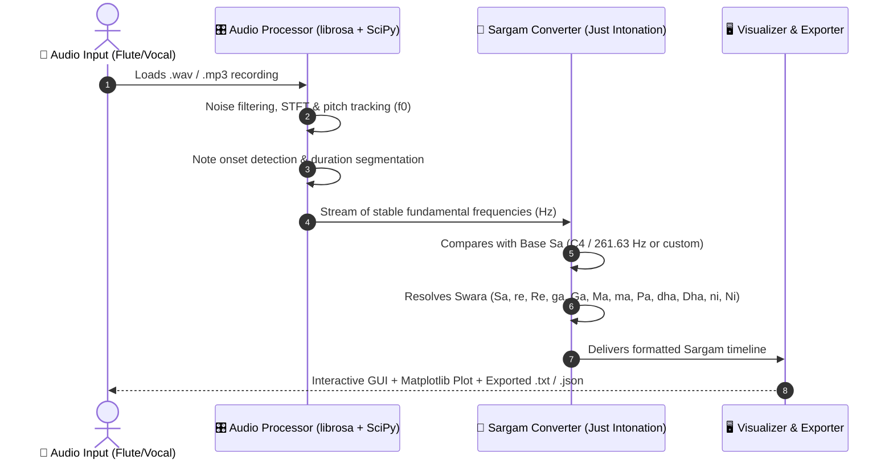

<div align="center">

  

  <p align="center">
    <b>Transform audio recordings into authentic Indian Classical Sargam notation (सा रे ग म प ध नि) with multi-octave pitch detection, Komal notes, and interactive GUI & mobile apps.</b>
  </p>

  <p align="center">
    <a href="https://www.python.org/"></a>
    <a href="https://librosa.org/"></a>
    <a href="https://kivy.org/"></a>
    <a href="https://matplotlib.org/"></a>
    <a href="LICENSE"></a>
  </p>

  <h3>
    <a href="#-features">Features</a> •
    <a href="#-how-it-works">How It Works</a> •
    <a href="#-sargam-tuning-matrix">Tuning Matrix</a> •
    <a href="#-quickstart">Quickstart</a> •
    <a href="#-cli-options">CLI Options</a> •
    <a href="#-gui--mobile">GUI & Mobile</a>
  </h3>
</div>

---

## ✨ Features

* 🎼 **Precise Pitch Tracking**: Leverages `librosa` harmonic pitch detection and YIN/pYIN algorithms to extract fundamental frequencies ($f_0$) across clean flute recordings and vocals.
* 🪕 **Just Intonation Mapping**: Frequency ratios calibrated to authentic Indian Classical Music tuning (Shuddha and Komal/Teevra swaras).
* 🎹 **3-Octave Span**: Automatically resolves **Mandra Saptak** (lower ₋), **Madhya Saptak** (middle), and **Taar Saptak** (upper ₊).
* 📊 **Visual Audio Analysis**: Plots interactive frequency timelines, energy spectra, and note segmentation graphs using `matplotlib`.
* 📱 **Desktop GUI & Mobile**: Includes Tkinter-based desktop interface and cross-platform Kivy / KivyMD mobile application.
* 💾 **Dual Format Export**: Exports transcriptions into clean, shareable `.txt` notation sheets and machine-readable `.json` data with timestamps.

---

## 🎼 The Transcription Pipeline



---

## 🎶 Sargam Tuning Matrix (Ratios relative to Base Sa)

| Swara | Notation | Type | Ratio ($f / f_{Sa}$) | Frequency (Base Sa = 261.63 Hz) |
|---|---|---|:---:|:---:|
| **Shadja** | **Sa** | Achala (Fixed) | `1.0` | 261.63 Hz |
| **Komal Rishabh** | **re (Re♭)** | Vikrit (Flat) | `16/15` (1.067) | 279.07 Hz |
| **Shuddha Rishabh** | **Re** | Shuddha (Natural) | `9/8` (1.125) | 294.33 Hz |
| **Komal Gandhar** | **ga (Ga♭)** | Vikrit (Flat) | `6/5` (1.200) | 313.96 Hz |
| **Shuddha Gandhar** | **Ga** | Shuddha (Natural) | `5/4` (1.250) | 327.04 Hz |
| **Shuddha Madhyam** | **Ma** | Shuddha (Natural) | `4/3` (1.333) | 348.84 Hz |
| **Teevra Madhyam** | **ma (Ma#)** | Vikrit (Sharp) | `45/32` (1.406) | 367.92 Hz |
| **Pancham** | **Pa** | Achala (Fixed) | `3/2` (1.500) | 392.45 Hz |
| **Komal Dhaivat** | **dha (Dha♭)** | Vikrit (Flat) | `8/5` (1.600) | 418.61 Hz |
| **Shuddha Dhaivat** | **Dha** | Shuddha (Natural) | `5/3` (1.667) | 436.05 Hz |
| **Komal Nishad** | **ni (Ni♭)** | Vikrit (Flat) | `9/5` (1.800) | 470.93 Hz |
| **Shuddha Nishad** | **Ni** | Shuddha (Natural) | `15/8` (1.875) | 490.56 Hz |

---

## ⚡ Quickstart

### 1. Clone & Install Dependencies
```bash
git clone https://github.com/DipjyotiT04/FluteN.git
cd FluteN
pip install -r requirements.txt
```

### 2. Run Interactive CLI Mode
```bash
python main.py
```

### 3. Run Desktop GUI
```bash
python run_gui.py
```

### 4. Run Mobile App (Kivy)
```bash
python main_mobile.py
```

---

## 💻 CLI Options

Transcribe an audio file with custom base scales or frequency tolerances:

```bash
python main.py recording.wav [options]
```

| Flag | Default | Description |
|---|:---:|---|
| `--base-freq` | `261.63` | Custom frequency of Base Sa in Hz (e.g., E flute = 329.63 Hz). |
| `--tolerance` | `50.0` | Maximum frequency tolerance window in Hz. |
| `--min-duration` | `0.1` | Minimum note duration in seconds to discard transient breath noise. |
| `--reference-audio` | `None` | Reference recording to automatically detect the flautist's tonic Sa. |
| `--output-dir` | `output` | Folder where generated `.txt`, `.json`, and plots are saved. |
| `--no-plot` | `False` | Disables visualization plot generation. |

#### Example: Transcribe an E-Base Flute with Auto-Plotting
```bash
python main.py samples/krishna_flute.wav --base-freq 329.63 --output-dir ./transcriptions
```

---

## 📂 Project Architecture

```
FluteN/
├── audio_processor.py              # DSP, STFT, pitch extraction, & onset filtering
├── sargam_converter.py             # Ratio mapper & octave classification
├── transcriber.py                  # Core pipeline orchestrating audio-to-sargam
├── sargam_transcriber_standalone.py# Self-contained CLI transcriber
├── gui_app.py / run_gui.py         # Tkinter desktop graphical interface
├── main_mobile.py                  # Kivy / KivyMD cross-platform mobile app
├── main.py                         # CLI entrypoint with argparse & interactive prompts
└── requirements.txt                # Dependencies (librosa, scipy, kivy, etc.)
```

---

<div align="center">
  <b>FluteN — Preserving Classical Indian Music Through Modern Signal Processing</b><br>
  <sub>Created by <a href="https://github.com/DipjyotiT04">Dipjyoti Talukdar</a></sub>
</div>
